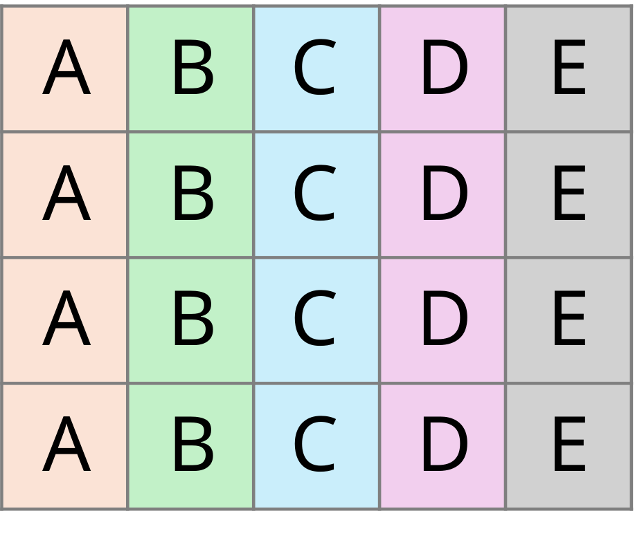
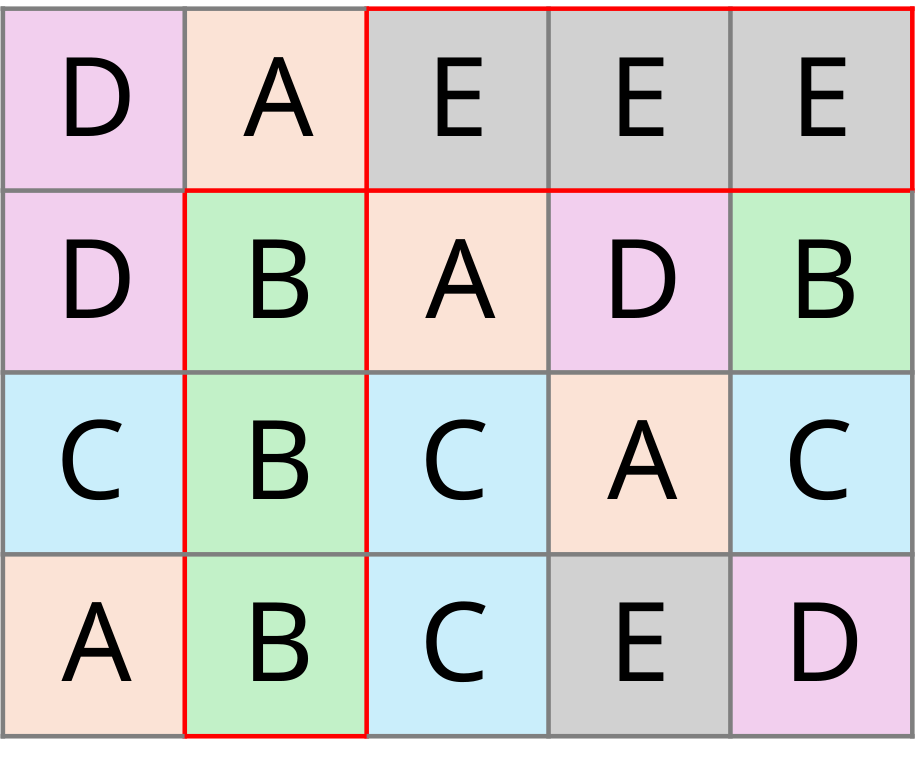
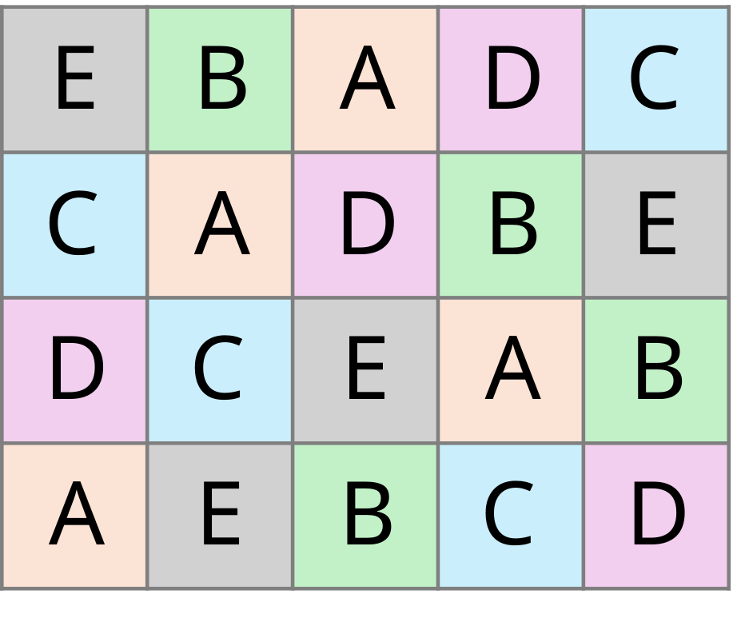

```{r}
#| label: setup
#| include: false
#| cache: false
library(speed)
# Invalidate the cache whenever the installed speed version changes
knitr::opts_chunk$set(cache.extra = packageVersion("speed"))

# Print one half of a design summary so it fits on a slide. "structure" is
# everything above the Evaluation section; "evaluation" is the title plus the
# Evaluation section.
summary_part <- function(x, part = c("structure", "evaluation")) {
  part <- match.arg(part)
  if (!inherits(x, "summary.design")) {
    x <- summary(x)
  }
  out <- capture.output(print(x))
  i <- grep("^Evaluation$", out)
  keep <- if (part == "structure") seq_len(i - 2) else c(1:3, i:length(out))
  cat(out[keep], sep = "\n")
  return(invisible(NULL))
}
try(ggplot2::theme_set(AAGIThemes::theme_aagi()), silent = TRUE)
```


## Remembrance Day

{fig-align="center" width="90%"}

::: {style="text-align: center;"}
*Lest we forget*
:::


## Plan for today

- Setup check
- Why spatial optimisation?
- How speed works
- Spatially optimised common designs
- Evaluating designs
- Designs with more complex structure
- MET designs
- Extensions (relationship matrices, custom objectives)
- Gotchas, getting help, Q&A

# Setup check

## Getting set up

- Workshop page: <https://aagi-aus.github.io/speed-workshop/>
- Slides and exercises are on that page. You can copy code from the slides.

```{r}
#| eval: false
# install.packages("pak")
pak::pak("biometryhub/speed")
```

<br><br>
I will assume a working knowledge of experimental design, but please ask if something isn't clear.

## Does it work for you?

```{r}
#| fig-align: center
#| output-location: column
library(speed)
d <- initialise_design_df(4, 4, 4)
autoplot(speed(d, 
      swap = "treatment", 
      seed = 1))
```

# Why spatial optimisation?

## Field heterogeneity and neighbours

::: columns
::: {.column width="60%"}

- Spatial trends are well known to exist in field trials[^1]
- Neighbour effects impact treatments
- Spatially optimised designs guard against a sub-optimal randomisation
- Alternatives are not FOSS and/or lack documentation and/or features

:::

::: {.column width="40%"}
{fig-align="center"}
:::
:::

[^1]: Gilmour, A. R., Cullis, B. R., & Verbyla, A. P. (1997). Accounting for Natural and Extraneous Variation in the Analysis of Field Experiments. _Journal of Agricultural, Biological, and Environmental Statistics, 2(3), 269–293._ https://doi.org/10.2307/1400446

## Restricted randomisation

- Impose some restrictions $\rightarrow$ improve spatial balance of treatments. 
- Optimisation problem...


:::: columns
::: {.column width="33%"}
{fig-align="center"}
:::

::: {.column width="33%"}
{fig-align="center"}
:::

::: {.column width="33%"}
{fig-align="center"}
:::
::::

# How speed works

## The workflow

1. Set up the layout (`initialise_design_df()` or otherwise)
2. `speed()`: optimise the layout
3. `autoplot()`: visualise it
4. `summary()`: evaluate it

## Four questions to ask of every design


| Question                           | Argument          |
| ---------------------------------- | ----------------- |
| What moves?                        | `swap`, `linked_cols`*         |
| Where is it allowed to move to?    | `swap_within`     |
| What should it be balanced across? | `spatial_factors` |
| What counts as a 'neighbour'?      | `grid_factors` + `...`   |

*: optional

::: notes
Every design in this workshop is an answer to these four questions.
Refer back to this slide for each new design: CRD, RCBD, split-plot, MET.
:::

## The default objective

- **Adjacency**: penalises the same treatment in neighbouring plots (*what counts as a neighbour?*)
- **Balance**: penalises a treatment repeating in the same rows or columns (*what should it be balanced across?*)
- Minimise the (optionally weighted) sum of these two components

## Simulated annealing in one slide

```{mermaid}
%%| echo: false
%%{init: {'theme': 'base', 'themeVariables': {'fontSize': '22px', 'fontFamily': 'Arial', 'lineColor': '#414042'}}}%%
flowchart LR
  A(["<span style='display:inline-block;padding:14px 30px;font-size:30px;font-weight:bold'>Design</span>"]) --> B["Swap two plots,<br/>score the new design"]
  B --> C{"Better?"}
  C -- "yes" --> D["Accept"]
  C -- "no" --> E["Sometimes accept<br/>(less often as it cools)"]
  D --> A
  E --> A
  A -- "optimal score or<br/>no improvement" --> H(["Stop"])

  classDef hub fill:#00808b,stroke:#004d54,stroke-width:5px,color:#ffffff
  classDef design fill:#00808b,stroke:#00808b,color:#ffffff
  classDef step fill:#f2f2f2,stroke:#00808b,color:#414042
  classDef good fill:#b6d438,stroke:#54921e,color:#414042
  classDef maybe fill:#ffbc42,stroke:#ec8525,color:#414042
  class A hub
  class H design
  class B,C step
  class D good
  class E maybe
```

```{r}
#| echo: false
#| label: annealing-progress
#| fig-height: 1.6
#| fig-align: center
# A real run: score at every iteration of an 8 x 4 CRD
demo_design <- initialise_design_df(items = 8, nrows = 8, ncols = 4)
demo <- speed(demo_design, swap = "treatment", seed = 42, quiet = TRUE)
progress <- data.frame(iteration = seq_along(demo$scores), score = demo$scores)
ggplot2::ggplot(progress, ggplot2::aes(iteration, score)) +
  ggplot2::geom_line(colour = "#00808b", linewidth = 1) +
  ggplot2::labs(x = "Iteration", y = "Score") +
  ggplot2::theme_bw()
```


# Spatially optimised common designs

## Spatially balanced design[^*]: set up the layout

```{r}
sbd_design <- initialise_design_df(items = 8, nrows = 8, ncols = 4)
head(sbd_design)
```


[^*]: Due to the restricted randomisation and optimisation applied to these designs, they are not strictly randomised, so this is not a completely randomised design. Hence we use slightly different terminology.

## SBD: the four questions

| Question                           | Argument          | Input   |
| ---------------------------------- | ----------------- | ------- |
| What moves?                        | `swap`            |  **`treatment`** |
| Where is it allowed to move to?    | `swap_within`     | default |
| What should it be balanced across? | `spatial_factors` | default |
| What counts as a 'neighbour'?      | `grid_factors`    | default |


## SBD: optimise

```{r}
#| code-line-numbers: "|2"
sbd_result <- speed(sbd_design,
                    swap = "treatment",
                    seed = 42)
```

```{r}
sbd_result
```


## SBD: plot

```{r}
#| fig-align: center
autoplot(sbd_result)
```


## Spatially balanced block design: set up the layout

```{r}
#| code-line-numbers: "|4"
sbbd_design <- initialise_design_df(
  items = paste0("V", 1:6), 
  nrows = 4, ncols = 6,
  block_nrows = 1, block_ncols = 6
)
```

## SBBD: the four questions

| Question                           | Argument          | Input   |
| ---------------------------------- | ----------------- | ------- |
| What moves?                        | `swap`            | **`treatment`** |
| Where is it allowed to move to?    | `swap_within`     | **`block`** |
| What should it be balanced across? | `spatial_factors` | default |
| What counts as a 'neighbour'?      | `grid_factors`    | default |

## SBBD: optimise

```{r}
#| code-line-numbers: "|2|3"
sbbd_result <- speed(sbbd_design,
                     swap = "treatment",
                     swap_within = "block",
                     seed = 42)
```

## SBBD layout

```{r}
#| fig-align: center
autoplot(sbbd_result)
```

## Your turn

**Exercise 1** (about 10 minutes, on the Exercises page)

- 8 varieties × 4 replicates in a 4 × 8 field
- Each block is a **2 × 4 patch**, not a whole row
- Answer the four questions, optimise, and check each block has every variety once

# Evaluating designs

## `summary()`: structure and optimisation

`summary(sbbd_result)`, part 1 of 2

```{r}
#| echo: false
summary_part(sbbd_result, "structure")
```

## `summary()`: evaluation

`summary(sbbd_result)`, part 2 of 2

```{r}
#| echo: false
summary_part(sbbd_result, "evaluation")
```

## What the sections tell you

- **Structure**: layout, replication, spatial factors
- **Optimisation**: final score split into adjacency and balance
- **Evaluation**: connectedness, concurrence, replicate span
- **Flags**: iteration cap reached, unequal replication, disconnected design

# Designs with more complex structure

## More complex design types

- Designs with hierarchy
- Designs with multiple treatments
- Designs with multiple sites

## Split-plot: describe the structure

```{r}
splits <- list(
  subplot   = list(items = letters[1:4], nrows = 1, ncols = 1),
  wholeplot = list(items = LETTERS[1:3], nrows = 1, ncols = 4),
  block     = list(nrows = 3, ncols = 4)
)
sp_design <- initialise_split_design_df(splits = splits, rep_dim = c(4, 1))
```

## Split-plot: the four questions {.smaller}

One answer per level (`wp`, then `sp`):

| Question                           | Argument          | Whole plots | Subplots |
| ---------------------------------- | ----------------- | ----------- | -------- |
| What moves?                        | `swap`            | **`wholeplot_treatment`** | **`subplot_treatment`** |
| Where?    | `swap_within`     | **`block`** | **`wholeplot`** |
| Balance | `spatial_factors` | default     | default  |
| Neighbour      | `grid_factors`    | default     | default  |

## Split-plot: optimise level by level

```{r}
#| code-line-numbers: "|3,8|4,9|5|14"
optimise <- list(
  wp = list(
    swap        = "wholeplot_treatment",
    swap_within = "block",
    swap_all    = TRUE
  ),
  sp = list(
    swap        = "subplot_treatment",
    swap_within = "wholeplot"
  )
)

sp_result <- speed(sp_design, 
  optimise = optimise, 
  seed = 42)
```

::: notes
swap_all = TRUE moves all subplots of a whole plot together.
:::

## Split-plot layout

::: columns
::: {.column width="50%"}
```{r}
#| echo: false
autoplot(sp_result, treatments = "wholeplot_treatment")
```
:::
::: {.column width="50%"}
```{r}
#| echo: false
autoplot(sp_result, treatments = "subplot_treatment", block = "wholeplot")
```
:::
:::

## p-rep: any data frame will do

```{r}
prep_design <- data.frame(
  row   = rep(1:14, each = 10),
  col   = rep(1:10, times = 14),
  block = rep(rep(1:2, each = 5), 14),
  entry = c(rep("check", 10),           # 1 check, 10 replicates
            paste0("V", rep(1:30, 2)),  # 30 varieties, 2 replicates each
            paste0("V", 31:100))        # 70 varieties, 1 replicate each
)
```

## p-rep: the four questions

| Question                           | Argument          | Input   |
| ---------------------------------- | ----------------- | ------- |
| What moves?                        | `swap`            | **`entry`** |
| Where?    | `swap_within`     | default |
| Balance | `spatial_factors` | **`~ block + row + col`** |
| Neighbour      | `grid_factors`    | default |

## p-rep: optimise

```{r}
#| code-line-numbers: "|2|3"
prep_result <- speed(prep_design,
                     swap = "entry",
                     spatial_factors = ~ block + row + col,
                     seed = 42)
```

::: notes
No initialise_ helper needed: any data frame with row/col works.
Block in spatial_factors balances the duplicated entries across blocks.

Why not swap_within = "block"? That restricts swaps to within a block, so
which entries sit in which block is frozen at whatever the starting layout
happened to be. Here the starting layout has both replicates of every
two-replicate variety in the same block (0/30 split across blocks), and
swap_within = "block" leaves it that way. With block in spatial_factors the
balance score penalises uneven block membership, so entries move between
blocks: 30/30 varieties end up with one replicate in each block. Blocks in a
p-rep are incomplete, so there is no "every treatment once per block" to
protect; contrast the RCBD, where blocks start complete and swap_within keeps
them complete.
:::

## p-rep layout

```{r}
#| fig-align: center
autoplot(prep_result, treatments = "entry")
```

## p-rep layout

```{r}
#| echo: false
#| fig-align: center
prep_df <- prep_result$design_df
prep_df$group <- ifelse(prep_df$entry == "check", "Check",
                        ifelse(prep_df$entry == "V1", "V1", "Other"))
ggplot2::ggplot(prep_df, ggplot2::aes(col, row, fill = group)) +
  ggplot2::geom_tile(colour = "grey70") +
  ggplot2::geom_text(
    ggplot2::aes(label = entry, colour = group == "Check"),
    size = 3
  ) +
  ggplot2::scale_fill_manual(
    values = c(Check = "#00808b", V1 = "#ffbc42", Other = "#ffffff")
  ) +
  ggplot2::scale_colour_manual(values = c("TRUE" = "#ffffff", "FALSE" = "#000000")) +
  ggplot2::scale_y_reverse() +
  ggplot2::theme_void() +
  ggplot2::theme(legend.position = "none")
```

::: notes
The check (teal) appears 10 times, 5 in each block. V1 (amber) is one of the
30 twice-replicated varieties: one replicate in each block. The other 70 are
single replicates (white).
:::

## Also covered in the vignettes

- Split-split plot and strip-plot
- Incomplete block designs
- Row–column designs with blocking
- `linked_cols`: keep variety names with their codes


## Your turn

**Exercise 2** (about 10 minutes, on the Exercises page)

- 4 tillage methods (whole plots) × 3 varieties (subplots), in 3 blocks
- Answer the four questions **for each level**, then optimise
- Check every block has every tillage method once, and every whole plot every variety once

# MET designs

## Several sites, one treatment set

```{r}
all_treatments <- c(rep(1:50, 7), rep(51:57, 8))
met_design <- initialise_design_df(
  items = all_treatments,
  designs = list(
    a = list(nrows = 28, ncols = 5, block_nrows = 7,  block_ncols = 5),
    b = list(nrows = 20, ncols = 3, block_nrows = 10, block_ncols = 3),
    c = list(nrows = 20, ncols = 4, block_nrows = 10, block_ncols = 4),
    d = list(nrows = 15, ncols = 4, block_nrows = 5,  block_ncols = 4),
    e = list(nrows = 22, ncols = 3, block_nrows = 11, block_ncols = 3)
  )
)
met_design$site_col   <- paste(met_design$site, met_design$col,   sep = "_")
met_design$site_block <- paste(met_design$site, met_design$block, sep = "_")
```

## MET: the four questions {.smaller #met-questions}

Two levels: first connect the sites, then balance within each site.

| Question | Argument          | Connectivity | Balance |
| -------- | ----------------- | ------------ | ------- |
| What moves?                        | `swap`            | **`treatment`** | **`treatment`** |
| Where?    | `swap_within`     | default      | **`site`** |
| Balance | `spatial_factors` | **`~ site`** | **`~ site_col + site_block`** |
| Neighbour      | `grid_factors`    | **`by = "site"`** | **`by = "site"`** |

## Optimise connectivity, then balance

MET Part 1

```{r}
#| code-line-numbers: "|6|3,7"
optimise <- list(
  connectivity = list(
    spatial_factors = ~ site
  ),
  balance = list(
    swap_within     = "site",
    spatial_factors = ~ site_col + site_block
  )
)
```

## Optimise connectivity, then balance

MET Part 2

```{r}
#| code-line-numbers: "|4|5|7"
met_result <- speed(
  data = met_design,
  swap = "treatment",
  optimise = optimise,
  grid_factors = list(dim1 = "row", dim2 = "col", by = "site"),
  early_stop_iterations = 5000,
  optimise_params = optim_params(random_initialisation = TRUE, adj_weight = 0),
  seed = 112, quiet = TRUE
)
```

::: notes
grid_factors `by` says each site is its own grid: plots at different sites
are never neighbours. Without it, sites reusing coordinates are refused.
:::

## MET layout

```{r}
#| echo: false
#| fig-align: center
ggplot2::ggplot(met_result$design_df,
                ggplot2::aes(col, row, fill = factor(treatment))) +
  ggplot2::geom_tile(colour = "black") +
  ggplot2::facet_wrap(~site, scales = "free", nrow = 1) +
  ggplot2::scale_y_reverse() +
  ggplot2::theme(legend.position = "none")
```

<!-- TODO: partial allocation across sites (allocation = NA fixes a site) -->

# Extensions

## Relationship matrices

Treat related entries as partial repeats when scoring adjacency.

```{r}
items  <- paste0("T", 1:16)
groups <- setNames(rep(c("A", "B", "C", "D"), each = 4), items)
rel <- matrix(0, 16, 16, dimnames = list(items, items))
within <- c(A = 0.8, B = 0.4, C = 0.1, D = 0.0)
for (g in names(within)) rel[items[groups == g], 
items[groups == g]] <- within[[g]]
diag(rel) <- 1
head(rel)
```

## Relationship matrices: optimise

```{r}
rel_design <- initialise_design_df(items = rep(items, 4), nrows = 8, ncols = 8,
                                   block_nrows = 4, block_ncols = 4)
rel_result <- speed(rel_design, swap = "treatment", swap_within = "block",
                    relationship = rel, seed = 42, quiet = TRUE)

rel_result               
```

## Relationship matrices: the effect

```{r}
#| echo: false
default_result <- speed(rel_design, swap = "treatment", swap_within = "block",
                        seed = 42, quiet = TRUE)
default_result$design_df$group <- groups[default_result$design_df$treatment]
rel_result$design_df$group <- groups[rel_result$design_df$treatment]
```

::: columns
::: {.column width="50%"}
```{r}
#| echo: false
#| fig-width: 4
autoplot(default_result, treatments = "group") +
  ggplot2::ggtitle("Default: identity only")
```
:::

::: {.column width="50%"}
```{r}
#| echo: false
#| fig-width: 4
autoplot(rel_result, treatments = "group") +
  ggplot2::ggtitle("With relationship matrix")
```
:::
:::

Tiles show each treatment's _relationship group_ (A: highly related, D: unrelated) not _treatment_.

::: notes
Both runs use seed 42. Group A (similarity 0.8) is pushed apart the most; group
D (0.0) is free to sit together, which is why D tiles still touch.

Measured on this design (related pairs among neighbours, weighted by the
matrix): default 6.8, with the relationship matrix 0.0. Over 20 seeds the
means are 7.3 and 0.0.

The final scores are identical (4.27) in both runs: neither has any
same-treatment neighbours, and both reach the same balance score. So the score
alone does not show the difference; the relationship only changes which
layouts count as good, not how good the best one scores.
:::

## Custom objectives

An objective returns a list with a `score`; lower is better.

```{r}
get_cooccurrence <- function(design_df, swap) {
  pairs <- unlist(lapply(unique(design_df$block), function(block) {
    combn(sort(as.character(design_df[design_df$block == block, swap])), 2,
          FUN = function(x) paste(x, collapse = ","))
  }))
  return(as.list(table(pairs)))
}

bibd_objective <- function(layout_df, swap, spatial_cols,
                           row_column = "row", col_column = "col", ...) {
  adj <- calculate_adjacency_score(layout_df, swap, row_column, col_column)
  bal <- calculate_balance_score(layout_df, swap, spatial_cols)
  pair_var <- var(as.numeric(get_cooccurrence(layout_df, swap)))
  return(list(score = round(adj + bal + 10 * pair_var, 10)))
}
```

## Custom objectives: a BIBD

```{r}
bibd_df <- initialise_design_df(items = 5, nrows = 3, ncols = 10,
                                block_nrows = 3, block_ncols = 1)
bibd_result <- speed(bibd_df, swap = "treatment",
                     spatial_factors = ~ block + row + col,
                     obj_function = bibd_objective,
                     optimise_params = optim_params(random_initialisation = TRUE),
                     seed = 42, quiet = TRUE)
unique(unlist(get_cooccurrence(bibd_result$design_df, "treatment")))
```

::: notes
v = 5, b = 10, k = 3, r = 6, lambda = 3: every pair together 3 times.
:::

## Custom objectives: every pair together 3 times

```{r}
#| echo: false
#| fig-align: center
# Highlight one pair of treatments in the blocks where they appear together
pair <- c("T1", "T2")
bibd_df_out <- bibd_result$design_df
blocks_both <- intersect(bibd_df_out$block[bibd_df_out$treatment == pair[1]],
                         bibd_df_out$block[bibd_df_out$treatment == pair[2]])
in_pair <- bibd_df_out$block %in% blocks_both
bibd_df_out$group <- ifelse(in_pair & bibd_df_out$treatment == pair[1], "first",
                            ifelse(in_pair & bibd_df_out$treatment == pair[2],
                                   "second", "other"))

ggplot2::ggplot(bibd_df_out, ggplot2::aes(col, row, fill = group)) +
  ggplot2::geom_tile(colour = "grey70") +
  ggplot2::geom_text(
    ggplot2::aes(label = treatment, colour = group == "first"),
    size = 5
  ) +
  ggplot2::scale_fill_manual(
    values = c(first = "#00808b", second = "#ffbc42", other = "#ffffff")
  ) +
  ggplot2::scale_colour_manual(values = c("TRUE" = "#ffffff", "FALSE" = "#000000")) +
  ggplot2::scale_x_continuous(breaks = 1:10, position = "top") +
  ggplot2::scale_y_reverse() +
  ggplot2::labs(x = "Block", y = NULL) +
  ggplot2::theme_void() +
  ggplot2::theme(legend.position = "none",
                 axis.text.x = ggplot2::element_text(),
                 axis.title.x = ggplot2::element_text())
```

T1 and T2 share a block exactly 3 times, like every other pair.

::: notes
Each column is a block of three plots. T1 and T2 sit together in blocks 1, 5
and 10 (in the seed-42 run); every other pair of the five treatments does the
same number of times (lambda = 3). With the default objective the pair counts
vary between 2 and 4.
:::

# Gotchas, getting help, Q&A

## Gotchas

- Treatment column not called `treatment`? Pass `treatments =` to `autoplot()`
- Companion columns (variety names) don't move unless named in `linked_cols`
- MET sites reuse coordinates: set `grid_factors = list(..., by = "site")`
- Check `summary()` flags: a run that hit the iteration cap may need more `iterations`

## Getting help

- Documentation and vignettes: <https://biometryhub.github.io/speed/>
- Bugs and feature requests: <https://github.com/biometryhub/speed/issues>
- `?speed`, `?initialise_design_df`, `?optim_params`

## Questions?

# Thank you {background-image="_extensions/AAGI-AUS/aagi/assets/title-slide-main.png" background-size="1050px auto" background-position="50% 100%"}
